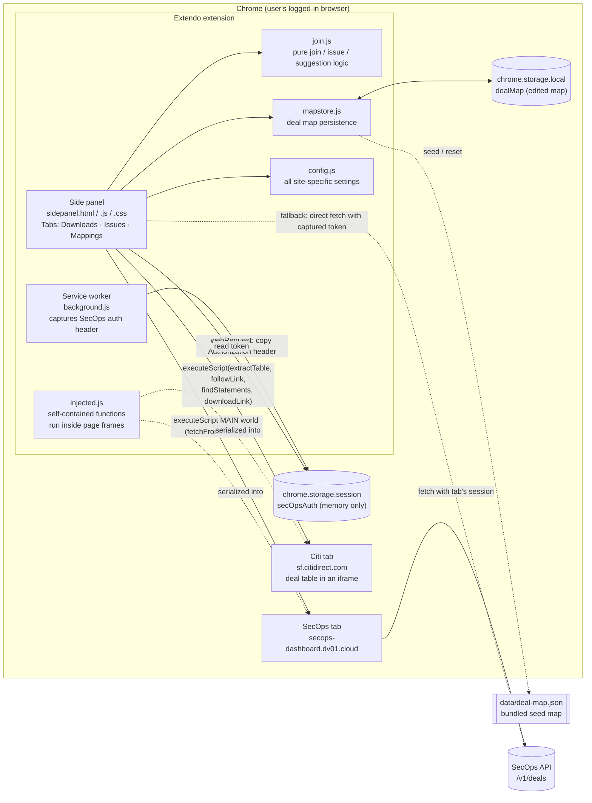

# CLAUDE.md

Guidance for Claude (and engineers) working on **Extendo**, a Chrome MV3 side-panel extension
for dv01 operations. It joins the deal list on **Citi**'s trustee site (sf.citidirect.com)
with deal status from dv01's **SecOps** dashboard (secops-dashboard.dv01.cloud), and helps
download Citi statements and maintain the mapping between the two.

User-facing install and usage docs live in `README.md`. This file covers how the code fits
together and what to keep intact when changing it.

## Naming: Citi and SecOps

The two sites that get user are Citi and SecOps.

- Prose and UI text: **Citi** and **SecOps** (capitalised).
- Identifiers: `citi` / `secOps` in JS (`CONFIG.citi`, `citiRows`, `citiTable`, `secOpsAuth`),
  `citi_` / `secops_` in Python, `SECOPS_DEAL` for the CSV column.
- Data values: output columns use `from: 'citi'` / `from: 'secOps'` (lowercase; `join.js`
  compares them exactly). Matched rows are `{ citi, secOps }`.
- Don't reintroduce `A`/`B`, `rowsA`, `pageB` and the like.

## Architecture



The side panel does all the work. It never scrapes with network calls of its own: it injects functions into the tabs the user is already logged into, so each site sees its own session.

### Files

| File | Owns |
| --- | --- |
| `manifest.json` | MV3 manifest. Repo copy is always the **dev build** (`"Extendo (dev)"`, `version_name: X.Y.Z-dev`). `host_permissions` must cover every URL in `config.js`, including Citi's iframe origin and the mock hosts. |
| `config.js` | Every site-specific value: URL patterns, SecOps API URL and response shape, Citi column headers, the downloadable report sections (`citi.statements`), the Issues filter, and the Downloads output columns. `MOCK_CITI` / `MOCK_SECOPS` switch each site to its local mock independently. |
| `background.js` | Opens the panel on toolbar click, sets the DEV badge, and captures SecOps's `Authorization` header from the dashboard's own requests into `chrome.storage.session`, tied to its tab. It clears that header on 401, tab close, or navigation away from SecOps. |
| `sidepanel.js` | UI and orchestration: tabs, Build table, Citi navigation and statement download, Issues, Mappings editor, import/export. Holds the in-memory state (`mapEntries`, `lastBuild`, `lastDeals`). |
| `join.js` | **Pure** logic, no `chrome.*`: `joinRows`, `project`, `unmappedDeals`, `suggestMapping`, `normalize`/`mapKey`. Testable with plain Node. |
| `mapstore.js` | Deal map load/save/reset. `chrome.storage.local['dealMap']` if edited, else `data/deal-map.json`. |
| `injected.js` | Functions passed to `chrome.scripting.executeScript`. **Must be self-contained** (no imports, no module scope): they are serialized into the target frame. |
| `data/deal-map.json` | Bundled seed map: `[{ issuer, series, dealId }]`, one entry per line. `dealId` = SecOps `dealName`. |
| `dev/mock-server.py`, `dev/fixtures.json` | Local stand-ins for Citi (:8765, iframe on 127.0.0.1) and SecOps (:8766). |
| `scripts/join_deals.py` | Offline helper that proposes mappings by matching Citi `(Issuer, Series)` rows to SecOps deal names. It generated the original `data/deal-map.json`. |
| `citi_map.csv`, `secops_deals.csv`, `citi_and_secops_deal_mapping.csv`, `deals.json` | Snapshots and outputs used for offline mapping work. `deals.json` is a SecOps `/v1/deals` response, handy for checking logic in Node. |
| `.github/workflows/release.yml` | On merge to `main`: bump version, tag, build release zip. |

### Build table flow (Downloads tab)

1. `requestHostAccess()`. It must be the **first await** in the click handler, or Chrome
   won't treat the permission prompt as user-initiated.
2. `loadDeals()` → `callSecOps()`: tries each SecOps tab, most recently used first, running
   `fetchFromSecOps` in the MAIN world. The captured token is only passed to the tab it came
   from. If every tab fails, it calls the API directly from the extension with the captured
   token. Auth errors (401/403) are preferred when reporting failure.
3. `loadCitiTable()`: injects `extractTable` frame by frame, because one blocked frame would
   fail an `allFrames` call. It takes the first `<table>` that has the Issuer and Series
   headers. Link hrefs are kept in `row._links`.
4. `joinRows()` on the current `mapEntries` gives `{ matched, unmapped, missingDeal }`.
   `project()` turns `matched` into output columns from `CONFIG.output`.
5. Clicking a linked cell calls `openOnCiti()`. It follows the link in whichever frame shows
   it, going back in history up to 3 times if Citi has moved on. It then polls
   `findStatements` until the Reports page shows any configured section heading. It returns
   each section's files `{href, year, month}`, newest first. `askWhichFiles()` shows one row
   per configured section: a checkbox, a range from `RANGES` (Latest / Last 3 / 6 / 12 / All,
   counting files, not calendar months), and the months covered. **A section whose newest
   file is older than the current month is flagged** (an older "latest" is a likely
   problem), with a summary warning when such a section is ticked. Missing sections are
   disabled. Choices `{checked, count}` per label come from the last Yes
   (`chrome.storage.local['statementPicks']`, updated only for sections that deal offered;
   an older array-of-labels value is read as Latest), or `default: true` in config before
   the first one. No leaves them unchanged. Yes runs `downloadLink` for each file, with a
   500 ms gap (`DOWNLOAD_GAP_MS`). **Stop downloads** ends the loop (`downloadRun`).

**One Citi operation at a time.** A table build, a deal opening and a deal's downloads each
claim Citi's tab (`claimCiti` / `releaseCiti`). While one holds it, deal links and the Build
buttons are disabled, because each would navigate Citi away from the page being read and a
still-running poll would read the wrong deal. A deal releases Citi while its question is
showing, so picking another deal or building then answers the question No. Anything new
that drives Citi's tab should claim it the same way. The user can still navigate the Citi tab
directly; downloads whose links are gone are reported as failed.
   A heading matches its label exactly or followed by a bracketed note
   ("Enhanced Loan-Level Data (report legends)"). To add a report type, add its heading to
   `CONFIG.citi.statements`.

**Build table (no SecOps)** runs the same flow without step 2: `joinRows` gets
`deals: null`, so every mapped Citi row matches with a stand-in deal holding only its id,
flagged `noSecOps`. `project()` then shows a column's `noSecOps` value (e.g. `'Unknown'` for
"Not Yet Available in GCP") instead of computing it. When adding a SecOps-derived output
column, give it a `noSecOps` value. This build doesn't touch Issues.

`lastBuild` keeps the Citi table and deals, so **editing a mapping re-joins immediately**
without refetching. `lastDeals` (from Build table or the Issues tab's own fetch) feeds
Issues.

### Issues and Mappings

- **Issues** = `unmappedDeals()`: SecOps deals accepted by `CONFIG.issues.include` (currently
  `trustee === 'Citi'`) whose `dealName` isn't any map entry's `dealId`. **Map…** calls
  `suggestMapping()`: the series is the last word of the deal name, and the issuer is the
  issuer most often mapped to the same shelf prefix (e.g. `SEMT` → Sequoia).
- **Mappings** edits `mapEntries` in place. Every change goes through `commitMap()`, which
  saves to storage and re-renders Downloads, Issues and the issuer datalist. An
  `(issuer, series)` key is unique: Add updates an existing key instead of duplicating it,
  and Import rejects duplicates. Export writes the same one-line-per-entry format as
  `data/deal-map.json`.

## Design decisions (keep unless deliberately changing)

- **Run requests inside the user's tabs.** Extendo has no credentials of its own. SecOps calls
  run in the SecOps tab's MAIN world, and Citi actions run in Citi's frames. Don't add server
  components, stored passwords or long-lived tokens.
- **Token handling is deliberately narrow.** The captured SecOps header lives only in
  `chrome.storage.session` (memory), is bound to its tab, and is cleared when that login may
  have ended. Never persist it to `storage.local` or send it to another tab.
- **The deal map is user-editable data, not code.** Extensions can't write their own files,
  so edits live in `chrome.storage.local` and reach the repo via Export → commit
  `data/deal-map.json`. Dev and release builds have different extension IDs and don't share
  storage.
- **`join.js` stays pure.** Put matching, filtering and suggestion logic there, not in
  `sidepanel.js`, so it can be checked in Node against `deals.json` and `data/deal-map.json`.
- **Site specifics go in `config.js`.** Selectors, labels, URLs, filters and columns belong
  there. Code reads `CONFIG.*`.
- **Matching rules:** Citi rows match map keys after `normalize()` (case- and
  whitespace-insensitive). Map `dealId` matches the SecOps `dealIdField` **exactly** (as
  strings). Issues uses the same exact rule, so "not an issue" means "will join".
- **No build step, no dependencies.** Plain ES modules loaded directly by Chrome, and the
  release zip is just `*.js *.html *.css data` plus a rewritten manifest. Adding a bundler or
  npm packages is a significant change. Discuss before doing it.

## Rules that must hold

- Every URL `config.js` uses must be in `manifest.json` `host_permissions`, including Citi's
  iframe origin.
  That includes the mock Citi iframe, `http://127.0.0.1:8765/*`: it looks like a duplicate
  of `localhost:8765`, but it's a different origin, and without it the mock deal table can't
  be read ("Frames not readable"). The release workflow strips all mock hosts, so keeping
  them costs nothing.
- Functions in `injected.js` must not reference imports or outer variables.
- `MOCK_CITI` and `MOCK_SECOPS` must be `false` when committing. The release workflow refuses
  to ship either as `true`.
- Don't hand-edit `version` in `manifest.json`. The workflow owns it.
- New release-zip files: if you add a top-level file type or folder the extension loads at
  runtime, update the `cp` line in `release.yml`.
- Escape-free DOM: build UI with `textContent` / `createElement` (see `el()`), never
  `innerHTML` with site data.

## Extending: common recipes

- **New Downloads column:** add to `CONFIG.output`, using `from: 'citi'` (header text) or
  `from: 'secOps'` (dotted field), or `value: (citiRow, deal) => …`. Add `sort` or `linkFrom`
  if needed, and `noSecOps` for what to show when built without SecOps. No code change.
- **Change or add issue rules:** adjust `CONFIG.issues.include` / `columns`. For a different
  kind of issue (e.g. map entries pointing to deals SecOps no longer returns, or Citi rows not
  in the map), add a pure function in `join.js` and a section in `renderIssues()`. Keep the
  tab badge count in sync.
- **New tab:** add a `role="tab"` button (`id="tab-<name>"`, `aria-controls="panel-<name>"`)
  and a matching `role="tabpanel"` section in `sidepanel.html`. `showTab()` wires it
  automatically. Give it its own status element and pass its id to `setStatus`.
- **New action on Citi:** write a self-contained function in `injected.js` and run it per
  frame via `tryFollowLink(tabId, href, action)` or a polling loop like
  `waitForStatement`. Citi replaces iframes as it navigates, so re-list frames each attempt.
- **New SecOps data:** if it's in `/v1/deals`, just read the field. For another endpoint,
  generalise `fetchFromSecOps` / `callSecOps` rather than adding a second auth path.
- **Deal map shape changes** (e.g. extra fields): update `parseImportedMap`, Export, the
  Mappings table, `data/deal-map.json`, and consider that users may have older shapes saved
  in `chrome.storage.local`.
- **Another trustee besides Citi:** this is a larger change. Today `CONFIG.citi`, the join
  keys and the statement logic assume one Citi site. Plan a per-source config structure
  first rather than duplicating code paths.

## Testing

- **Mock sites:** `python3 dev/mock-server.py`, set `MOCK_CITI` / `MOCK_SECOPS = true` (either or both), reload the extension, sign
  in at http://localhost:8766/, open http://localhost:8765/, then Build table. Fixtures in
  `dev/fixtures.json` cover matched/unmapped/missing rows, issues with and without a
  suggested issuer, multi-user tokens, expiry and logout. Add fixtures when adding a code
  path.
- **Pure logic in Node:**
  ```sh
  node --input-type=module -e "
  import fs from 'fs'; import { unmappedDeals } from './join.js';
  const deals = JSON.parse(fs.readFileSync('deals.json'));
  const map = JSON.parse(fs.readFileSync('data/deal-map.json'));
  console.log(unmappedDeals({ deals, mapEntries: map, dealIdField: 'dealName',
    include: (d) => d.trustee === 'Citi' }).length);"
  ```
- **Syntax checks:** `node --check <file>.js`, `python3 -m py_compile scripts/join_deals.py`.
- There is no automated UI test. After UI changes, load unpacked and exercise each tab against
  the mocks.

## Release

PR merged to `main` → `release.yml` bumps the version (PR label `major` / `minor`, default
patch; `no-release` skips), tags `vX.Y.Z`, and publishes `extendo-vX.Y.Z.zip` with the dev name,
`-dev` label and mock hosts stripped. Users install from the GitHub release via Load unpacked.

## Conventions

- Match the existing style: 2-space indent, single quotes, trailing commas, arrow helpers,
  `const $ = (id) => document.getElementById(id)`.
- Comments explain *why* (site quirks, Chrome constraints), not what. Keep that density.
- User-facing errors say what to do next ("Reload the SecOps tab, then retry.").
- Diagnostic logs use the `Extendo:` prefix.
- Commits and PRs need the `Co-Authored-By` trailer required by org policy.
